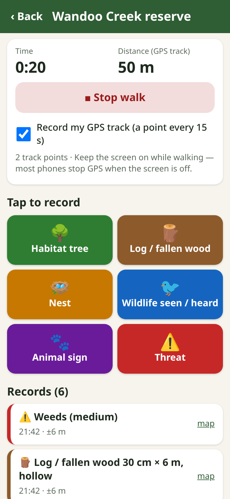
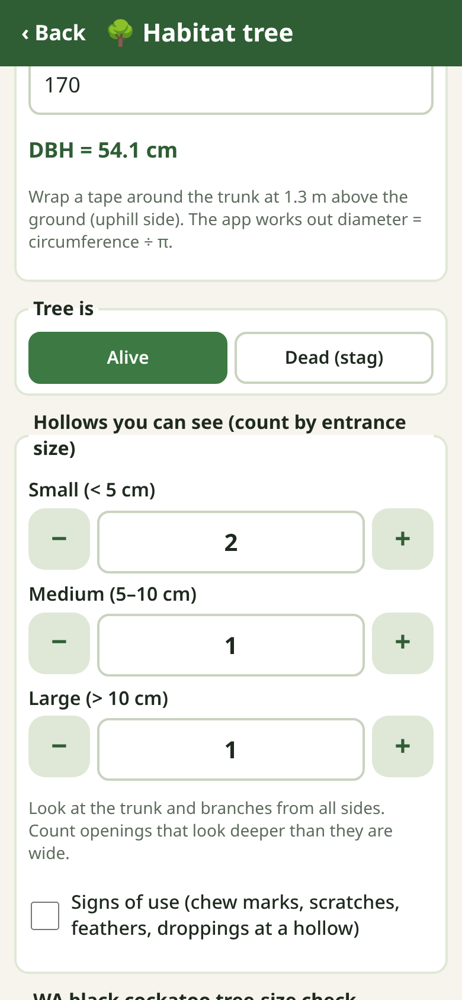
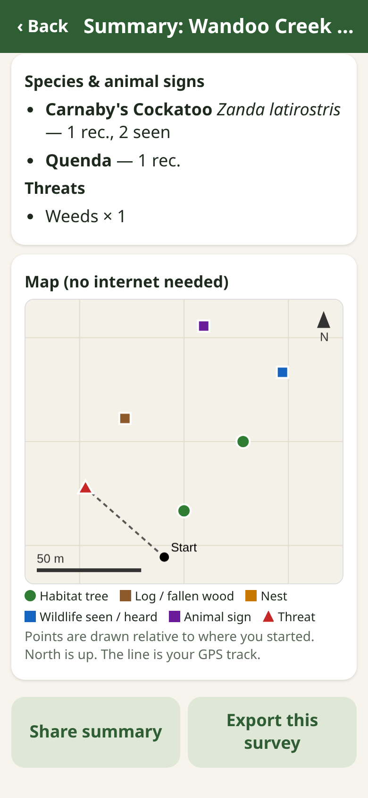

# Habitat Survey

A **free** phone app for simple, citizen-science-friendly **habitat and wildlife-sign surveys**: habitat trees and hollows, dead stags, logs, nests, wildlife sightings, animal signs (scats, tracks, diggings, feathers…) and threats (weeds, ferals, erosion, rubbish).

For landcare groups, landholders, rangers, volunteers and schools — usable anywhere in the world. Plain language, works on cheap Android phones, **works fully offline after the first load**, no account, no server, no adverts. Data stays on your phone until you export it.

**Open the app:** https://johnrichardszpe-dot.github.io/habitat-survey/
(Then use the browser menu → *Add to Home screen* / *Install app*.)

By **John Richards**. Version 0.1.0.

  

> **Not a formal survey.** Habitat Survey is a field notebook. It is not a Habitat Hectares, BAM, Bushland Condition Monitoring or EPBC-standard survey, and the black cockatoo check is **indicative only**.

## How to use
1. **New survey** — name the site, choose how you are surveying (incidental, area search, point count, transect) and, if you searched a set area, enter it in hectares (quick picks: 50 × 20 m plot = 0.1 ha, 1 ha, 2 ha).
2. **Start walk** (optional) — times your search and records a GPS track point every ~15 s. Keep the screen on.
3. **Tap a big button** when you find something: *Habitat tree, Log, Nest, Wildlife, Sign, Threat*. GPS (with accuracy) and time are taken automatically; fill in what you know; add photos (compass bearing saved). Tick **Sensitive** for threatened species, active nests or hollows in use.
4. **Stop walk → Summary & map** — counts by type, habitat trees / stags / hollow-bearing trees per hectare, hollows by size class, log length, species list, threats, and a map of your points drawn without internet (each record also has an OpenStreetMap link for when you are online).
5. **Share summary** (text) or **Export**: species records as **Darwin Core CSV**, all records CSV, or a JSON backup (restore on another phone). Choose coordinate rounding for sensitive records.

## What each record holds
| Type | Fields |
|---|---|
| Habitat tree | species (free text), circumference → DBH (= circumference ÷ π) or diameter, alive / dead stag, hollows by entrance size (small < 5 cm, medium 5–10 cm, large > 10 cm), signs of use, WA black cockatoo DBH check |
| Log / fallen wood | diameter (cm), length (m), hollow yes/no |
| Nest | type, height, active/old, species if known |
| Wildlife | common name, optional scientific name, count, behaviour, heard only |
| Animal sign | scat, tracks, diggings, feathers, chewed food, scratches, burrow, bones; animal if known |
| Threat | weeds, feral animal sign, erosion, rubbish, dieback, fire, clearing; severity |

Every record: GPS lat/lon, accuracy (m), timestamp, notes, sensitive flag, optional photos with bearing.

## Methods and sources
- **WA black cockatoo tree size (indicative):** *DSEWPaC (2012) EPBC Act referral guidelines for three threatened black cockatoo species* — “breeding habitat” = trees of species known to support breeding, within range, that have a suitable nest hollow **or** a suitable DBH to develop one: **500 mm DBH for most tree species, 300 mm for salmon gum and wandoo** ([PDF](https://www.agriculture.gov.au/sites/default/files/documents/referral-guidelines-wa-black-cockatoo.pdf)). *DAWE (2022) Referral guideline for 3 WA threatened black cockatoo species* (Carnaby’s, Baudin’s, Forest Red-tailed) — suitable nest hollows are only found in **live trees with DBH ≥ 500 mm**; trees **300–500 mm DBH** may develop a nest hollow in future ([page](https://www.dcceew.gov.au/environment/epbc/publications/referral-guideline-3-wa-threatened-black-cockatoo-species-2022)). The app shows: ≥ 500 mm (or ≥ 300 mm if you pick salmon gum / wandoo) = “meets the guideline size”; 300–499 mm for other trees = “possible future nest tree”; otherwise “below”. Thresholds were checked against the text of both guidelines. The helper appears when the survey is ticked *Western Australia* (auto-ticked if your GPS is in WA).
- **Hollow-bearing trees and logs:** NSW Biodiversity Assessment Method plot summary (hollow entrance ≥ 5 cm and ≥ 1 m above ground; logs ≥ 10 cm diameter and ≥ 0.5 m long, 50 × 20 m = 0.1 ha plots) ([PDF](https://data.nsw.gov.au/data/dataset/eba20049-ce63-47df-ac2b-34ef0353b35b/resource/d83efb88-7fb7-4d6b-9069-ec507adc10e8/download/d01878773-methodology-plot-layout-summary.pdf)); NESP Threatened Species Hub factsheet on tree-hollow abundance (entrance classes small < 5, medium 5–10, large 10–20, very large > 20 cm — merged here as large > 10 cm) ([PDF](https://www.nespthreatenedspecies.edu.au/media/x1yndczo/1-1-1-tree-hollow-abundance-in-tropical-savannas-reseearch-findings-factsheet.pdf)). Ground counts under- and over-count hollows (double-sampling studies: [Forest Ecology and Management 2004](https://doi.org/10.1016/j.foreco.2003.10.022); [Austral Ecology 2011](https://doi.org/10.1111/j.1442-9993.2010.02145.x)).
- **Quick condition score (0–10, optional):** five items scored 0–2 (native canopy, native understorey, weeds, logs & litter, big old trees & hollows). Inspired by Parkes, Newell & Cheal (2003) “habitat hectares” (*Ecological Management & Restoration* 4: S29–S38) and the Nature Conservation Society of SA *Bushland Condition Monitoring* manual — **it is not either method** and its scores cannot be compared with theirs.
- **Search effort:** methods follow common bird-survey practice — BirdLife Australia Birdata (2-ha 20-minute search, area and incidental searches) and eBird (stationary/point, travelling and incidental checklists). Walk time and distance are recorded as effort.
- **Data standard:** [Darwin Core terms (TDWG)](https://dwc.tdwg.org/terms/) and [ALA: sharing a dataset](https://support.ala.org.au/support/solutions/articles/6000261427-sharing-a-dataset-with-the-ala) (required: occurrenceID, basisOfRecord, scientificName, decimalLatitude/Longitude, geodeticDatum, coordinateUncertaintyInMeters, eventDate). iNaturalist/eBird take similar what/where/when/how-sure fields.
- **Sensitive species:** Chapman AD (2020) *Current Best Practices for Generalizing Sensitive Species Occurrence Data*, GBIF ([doi](https://doi.org/10.15468/doc-5jp4-5g10)).

## Darwin Core CSV
Rows are made for **sightings, signs and nests that have a common or scientific name** (habitat trees, logs and threats are habitat features, not species occurrences — they are in the “all records” CSV). Columns:
`occurrenceID, basisOfRecord (HumanObservation), occurrenceStatus (present), scientificName, vernacularName (common name), individualCount, behavior, eventDate (ISO 8601 with UTC offset), eventID, samplingProtocol, samplingEffort, decimalLatitude, decimalLongitude, geodeticDatum (WGS84), coordinateUncertaintyInMeters, dataGeneralizations, locality, recordedBy, occurrenceRemarks, associatedMedia`.
Review names before uploading (ALA matches on `scientificName`; add it where you can). Sign records describe indirect evidence in `occurrenceRemarks`.

**Coordinate rounding:** choose exact, 0.001° (~100 m), 0.01° (~1 km) or 0.1° (~10 km), for sensitive records only or all records. Rounded rows get `dataGeneralizations` and a larger `coordinateUncertaintyInMeters` (GPS accuracy + half the diagonal of the rounding cell).

**Spreadsheet safety:** all CSV text starting with `= + - @` or a tab is prefixed with `'` so it cannot run as a formula (numbers like `-31.95` are left as numbers).

## Protect wildlife
Do not post exact locations of nests, hollows in use or threatened species publicly. Use rounding when you share, and send precise records only to your state wildlife agency or a trusted data portal that hides sensitive locations.

## Honest limits
- Field notebook, not a formal or regulatory survey. The cockatoo check compares trunk size only; real breeding value needs an expert (tree species, range, hollow size, height, orientation, evidence of use).
- Phone GPS is often ±5–20 m, worse under canopy. Track recording can stop if the screen turns off or the app is in the background.
- Species names are free text; the app does not identify species.
- Data lives only on this phone; clearing browser data deletes it — export backups. English only for now (all text is in `strings.js` for translation).

## For developers
Plain HTML/CSS/JS, no build step. `node test.js` — DBH, per-ha, coordinate rounding, CSV escaping / formula-injection guard, Darwin Core mapping, summary. `browser-test.js` (puppeteer-core + Chrome) runs a whole survey, photo, summary, export and an offline reload: `PUPPETEER=/path/to/puppeteer-core node browser-test.js http://localhost:8000/ shot.png`. When you change any file, bump `CACHE` in `sw.js`.

## More free tools by John Richards
- 🌲 [Tree Gauge](https://johnrichardszpe-dot.github.io/tree-gauge/) — forest basal area with the phone camera (angle-gauge method)
- 🌱 [Planting Survey](https://johnrichardszpe-dot.github.io/planting-survey/) — seedling survival %, trees per hectare and photo points
- 🔥 [Fuel Check](https://johnrichardszpe-dot.github.io/fuel-check/) — simple step-by-step bushfire fuel hazard check
- 🧭 [Forest Explorer](https://johnrichardszpe-dot.github.io/forest-explorer/) — school forest science kit: height, trunk, carbon
- 🦜 [Habitat Survey](https://johnrichardszpe-dot.github.io/habitat-survey/) — habitat trees, hollows, wildlife sightings and signs *(this app)*
- 🍎 [Orchard Counter](https://johnrichardszpe-dot.github.io/orchard-counter/) — row-by-row tree counts, gaps, replant list, yield sample
- 🚧 [Roadside Trees](https://johnrichardszpe-dot.github.io/roadside-trees/) — roadside and powerline tree hazards, trimming and work lists
- 🌌 [Universe map](https://johnrichardszpe-dot.github.io/universe-map/) — explore John Richards' map of the universe

The same list is in the app (About / More tools screen), from the shared `more-tools.js`.

Released under the MIT Licence (see LICENSE). Free for anyone, anywhere, to use, change and share. Copyright (c) 2026 John Richards.
